

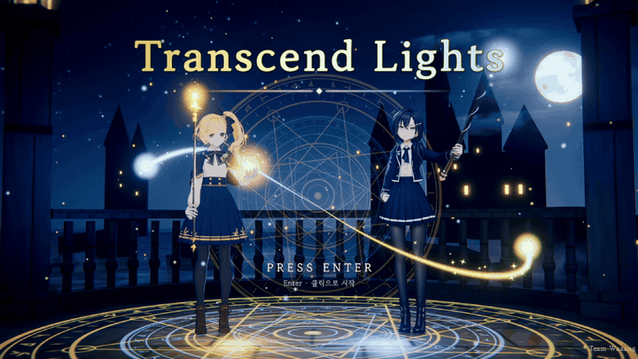

# ✦ Transcend Lights ✦

🏆 **2026 게임인재원 AI 해커톤 대상 수상작**

**휴대폰이 지팡이가 되는 2인 협동 마법학교 액션** 
아멜리아의 금빛과 녹스의 푸른빛, 두 개의 빛이 하나가 될 때 저주가 풀린다.

 

PC에서 게임을 실행한 뒤 안드로이드 휴대폰에서 <b>지팡이 앱</b>을 실행해 연결합니다 · <a href="https://github.com/Team-Waaang/ai-hackathon/releases/latest">전체 릴리스</a>

## 🎬 플레이 영상

**▶ [YouTube에서 보기](https://youtu.be/V0PtipGv1Rg?si=ScTvuoYnzpyDtYRY)**

 

## ✨ 게임 소개

|                 |                                                                           |
| --------------- | ------------------------------------------------------------------------- |
| **장르**        | 2인 협동 캐주얼 액션 (로컬 멀티플레이)                                    |
| **플레이 인원** | 2명 (휴대폰이 없는 플레이어는 마우스로 플레이 가능)                       |
| **조작**        | 휴대폰 = 지팡이 (AR 이미지 인식 / 자이로 에어마우스)                      |
| **플랫폼**      | PC (Windows · macOS) + Android 휴대폰 컨트롤러                            |
| **엔진**        | Unity 6000.4.7f1 (URP 17, Cinemachine 3, Timeline, Input System, lilToon) |

### "게임 안에, 모두를 담다"

**누구나 가지고 있는 휴대폰**을 들고 화면을 가리키기만 하면 됩니다. 복잡한 버튼 조합이나 게임 숙련도의 필요 없이
**가리키고 누르는 것**만으로 모든 교시를 진행할 수 있으므로 게임을 처음 해 보는 사람도 쉽게 플레이할 수 있습니다.

 

## 🏫 마법학교의 하루

### 입학 · 지팡이 연결

<table>
  <tr>
    <td width="50%">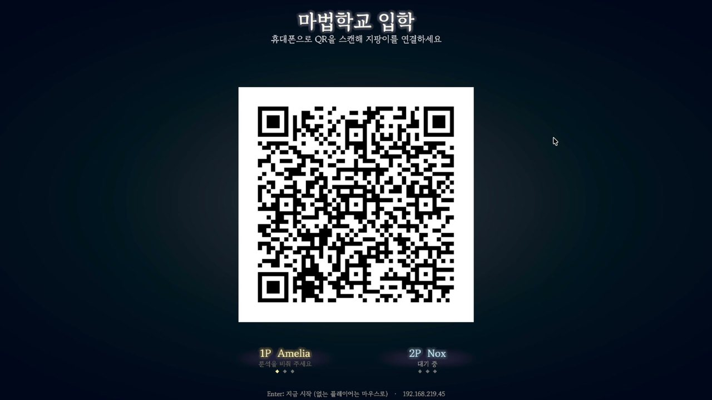</td>
    <td width="50%">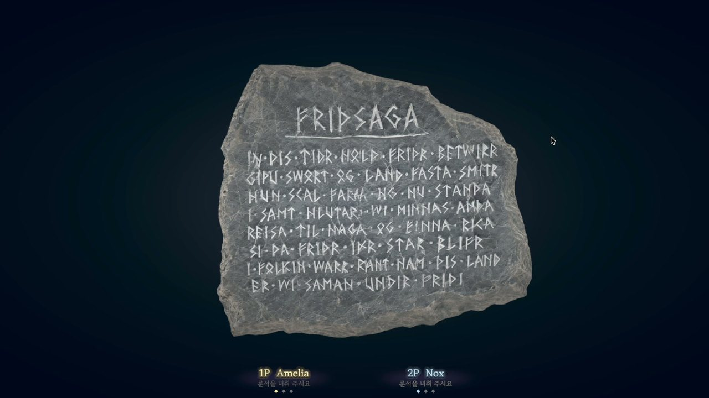</td>
  </tr>
  <tr>
    <td align="center">휴대폰으로 <b>QR</b>을 스캔해 연결</td>
    <td align="center">화면 속 <b>룬 석판</b>을 비춰 지팡이를 등록</td>
  </tr>
</table>

### 1교시 · 룬

<table>
  <tr>
    <td width="50%">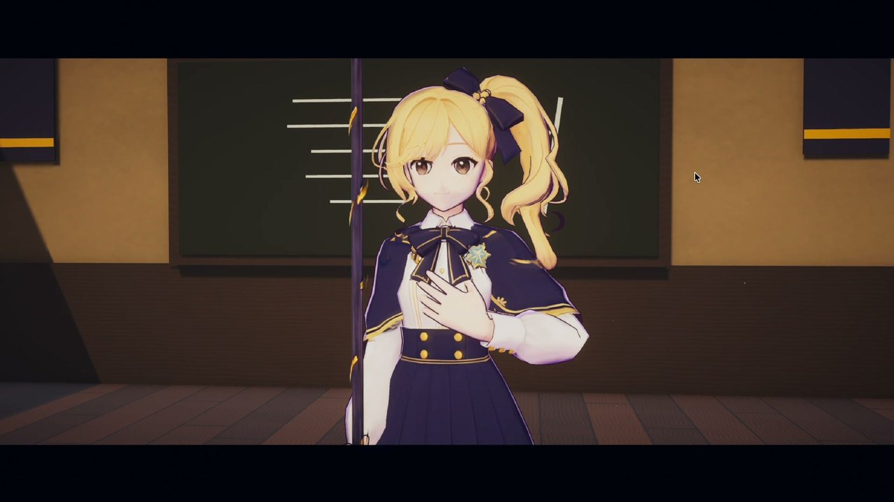</td>
    <td width="50%">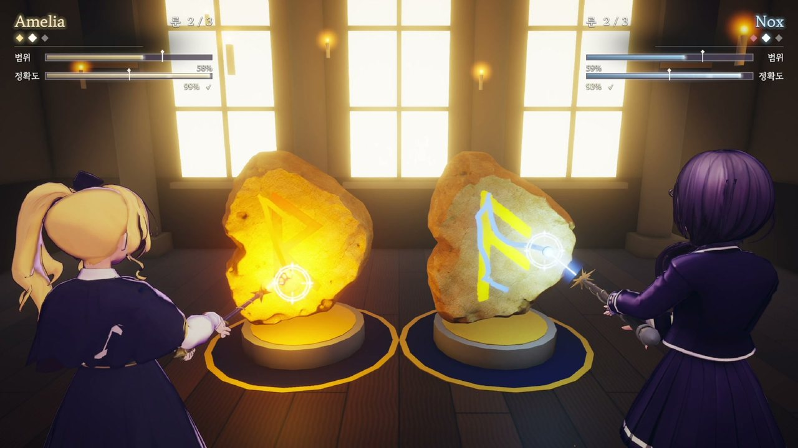</td>
  </tr>
  <tr>
    <td align="center">햇살 드는 룬 교실, 도입 컷신과 양피지 타이틀</td>
    <td align="center">룬 따라그리기</td>
  </tr>
</table>

### 2교시 · 암흑

<table>
  <tr>
    <td width="50%">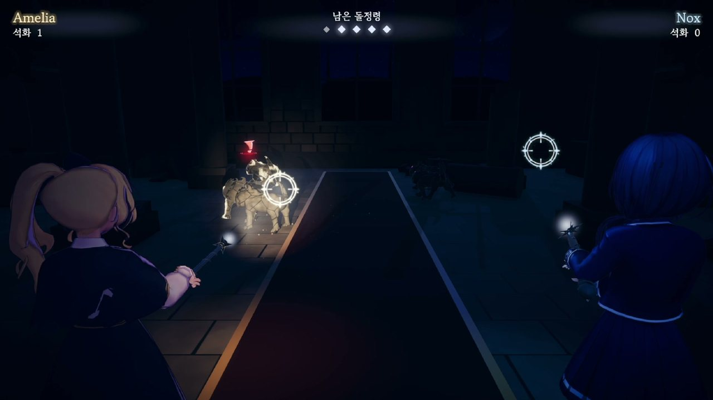</td>
    <td width="50%">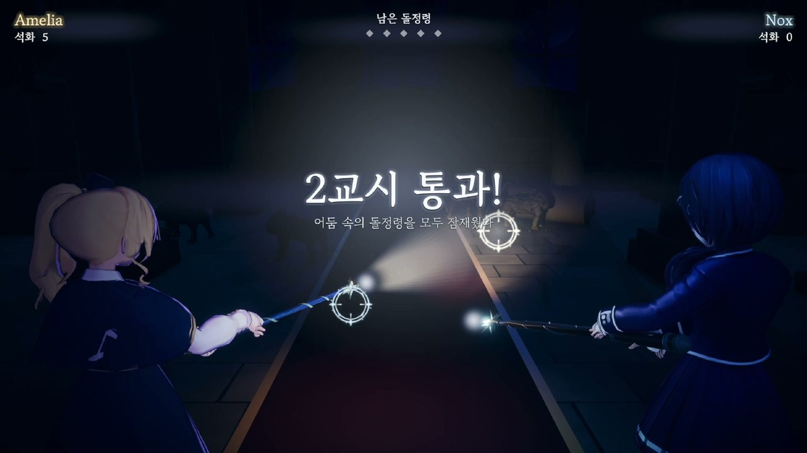</td>
  </tr>
  <tr>
    <td align="center">불 꺼진 복도에서 지팡이 빛으로 <b>숨은 돌정령</b>을 비춰 석화시키기</td>
    <td align="center">모두 석화시키면 통과</td>
  </tr>
</table>

### 3교시 · 보스전 「저주받은 아이」

<table>
  <tr>
    <td width="50%">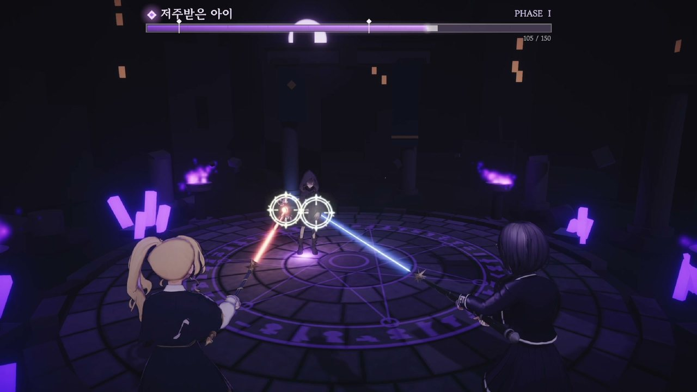</td>
    <td width="50%">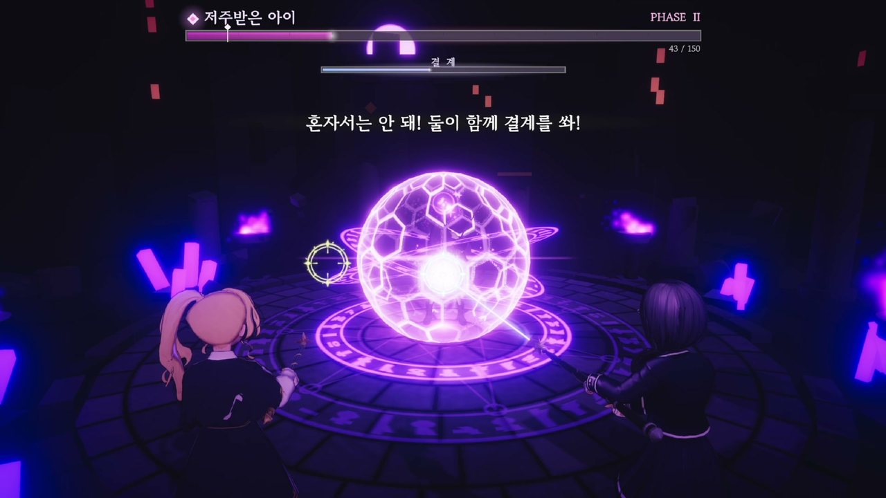</td>
  </tr>
  <tr>
    <td align="center">두 레이저가 근처에 있으면 <b>공명</b>으로 피해 1.5배</td>
    <td align="center"><b>함께</b> 쏴야만 깨지는 결계</td>
  </tr>
  <tr>
    <td width="50%">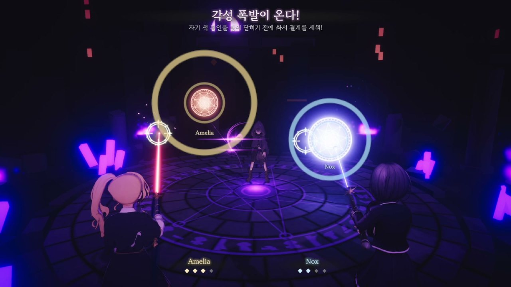</td>
    <td width="50%">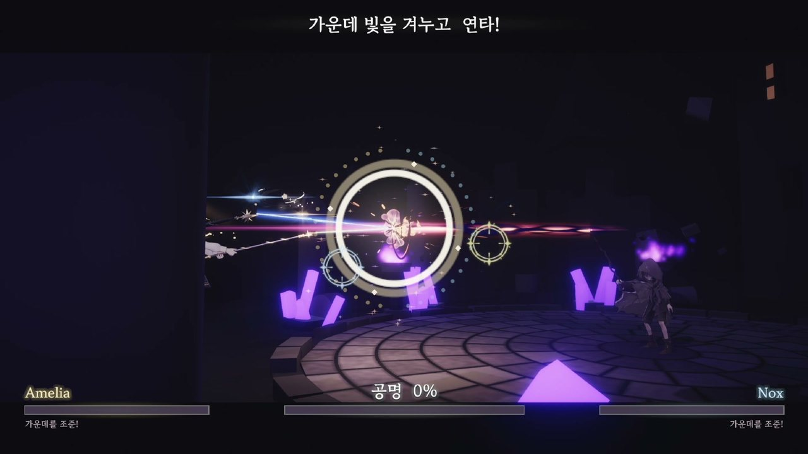</td>
  </tr>
  <tr>
    <td align="center">2페이즈 시작 <b>결계 QTE</b>: 링이 닫히기 전에 발사</td>
    <td align="center">마지막 <b>공명 QTE</b>: 가운데를 겨누고 함께 연타</td>
  </tr>
  <tr>
    <td width="50%">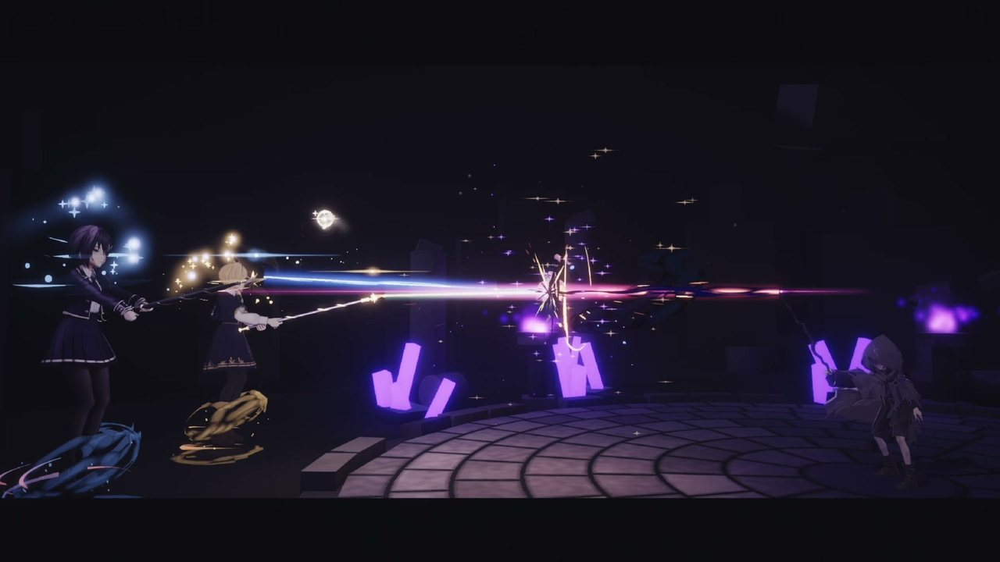</td>
    <td width="50%">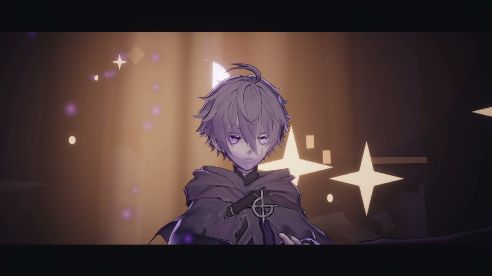</td>
  </tr>
  <tr>
    <td align="center">두 빛이 하나로, <b>ULTIM@TE☆BE∀M!!</b></td>
    <td align="center">저주가 풀리고 정화된 소년</td>
  </tr>
</table>

보스는 저주 구슬 발사, **돌정령 소환**, **분신**, **저주 사슬**(플레이어를 묶는 패턴), 결계를 섞어 공격합니다.

### 수업 끝 · 전투 결과

  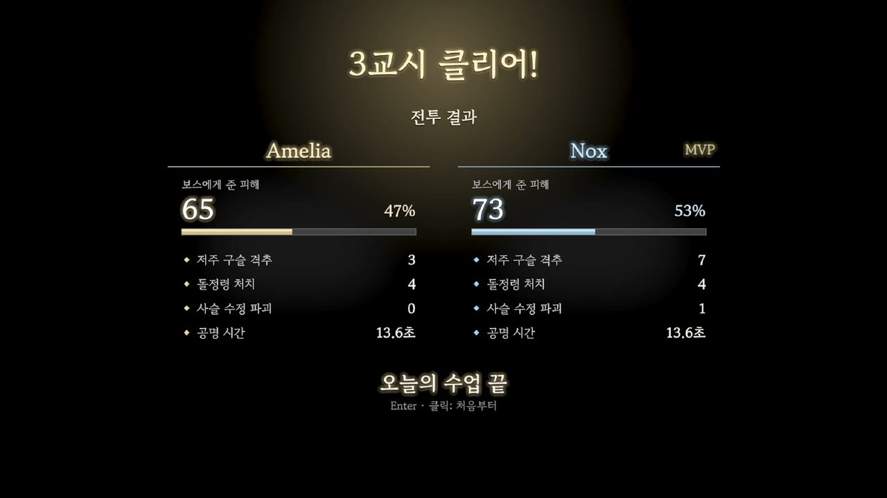 
  보스에게 준 피해와 비율, 구슬 격추·돌정령 처치·사슬 수정 파괴·공명 시간, MVP

 

## 🎮 플레이 방법

### 준비물

- **PC** 1대 (Windows 10 이상 또는 macOS) — 게임 실행
- **Android 휴대폰** 최대 2대 (ARCore 지원 기기, Android 7.0 이상) — 지팡이 앱 실행
- PC와 휴대폰이 **같은 Wi-Fi(LAN)** 에 연결되어 있어야 합니다.

### 설치

| 대상                  | 다운로드                                                                                                                        | 실행                                                                                                      |
| --------------------- | ------------------------------------------------------------------------------------------------------------------------------- | --------------------------------------------------------------------------------------------------------- |
| **Windows**           | [TranscendLights-Windows.zip](https://github.com/Team-Waaang/ai-hackathon/releases/latest/download/TranscendLights-Windows.zip) | 압축을 풀고 `TranscendLights.exe` 실행. 방화벽 허용 창이 뜨면 **허용** (휴대폰 연결에 필요)               |
| **macOS**             | [TranscendLights-macOS.zip](https://github.com/Team-Waaang/ai-hackathon/releases/latest/download/TranscendLights-macOS.zip)     | 압축을 풀고 `TranscendLights.app`을 **우클릭 → 열기** → 설정 앱의 개인정보 보호 및 보안에서 "그래도 열기" |
| **Android 지팡이 앱** | [TranscendLights-Wand.apk](https://github.com/Team-Waaang/ai-hackathon/releases/latest/download/TranscendLights-Wand.apk)       | 휴대폰에서 APK를 받아 설치 (출처를 알 수 없는 앱 설치 허용 필요)                                          |

### 휴대폰 연결과 게임 시작

1. PC에서 게임을 실행하고 메인 화면에서 **Enter** 또는 클릭
2. 휴대폰에서 **지팡이 앱**을 실행하고 화면의 **QR 코드를 스캔**
3. 안내에 따라 화면 속 **룬 석판을 비춰 인식** (설정에서 자이로/에어마우스 모드로 변경 가능)
4. 화면 가운데를 가리키고 좌측 하단 **CENTER** 버튼으로 보정
5. 두 대가 모두 연결되면 자동으로 1교시가 시작됩니다. 모두 연결하지 않은 상태에서 Enter를 입력하면 휴대폰이 연결되지 않은 캐릭터는 마우스를 이용해서 조작할 수 있습니다.

### 조작

| 입력                  | 휴대폰 (지팡이 앱)       | 마우스 대체 조작                         |
| --------------------- | ------------------------ | ---------------------------------------- |
| 조준                  | 휴대폰으로 화면 가리키기 | 마우스 이동                              |
| 마법 발사 / 룬 그리기 | 화면을 누르고 있기       | **1P Amelia** 좌클릭 · **2P Nox** 우클릭 |
| 조준 보정             | 좌측 하단 **CENTER**     | —                                        |
| 시작 · 건너뛰기       | —                        | **Enter** / **Space**                    |

 

## 🛠 주요 기능

- **휴대폰 지팡이 컨트롤러** — AR 이미지 인식(ARCore) 또는 자이로 에어마우스로 휴대폰이 가리키는 화면 지점을 계산해 LAN으로 전송합니다.
  최대 2대를 동시에 연결할 수 있습니다. 휴대폰을 누르면 휴대폰 화면의 지팡이에서도 플레이어 색 마법 이펙트가 나타납니다.
- **마우스 대체 조작** — 휴대폰이 연결되지 않은 캐릭터는 마우스를 이용해서 조작할 수 있습니다.
- **IK 캐스터 리그** — 조준점에 맞춰 팔·손목·머리가 실시간으로 따라갑니다.
- **세 가지 교시, 세 가지 규칙** — 룬 따라 그리기, 빛 비추기, 협동 보스전.
- **컷신** — 교시 도입부와 보스 등장·2페이즈·정화 컷신을 Timeline으로 제작했습니다. 정화 컷신에는 실시간 공명 QTE를 배치했습니다.
- **라이브 메인 화면** — 구름바다 위 밤 테라스에서 두 사람을 감싸는 빛의 리본, 돌아가는 마법진, 풍등과 유성으로 구성했습니다.
- **AI 보이스** — Amelia, Nox, 보스의 상황별 대사를 AI 더빙으로 제작했습니다.
- **사운드** — 효과음 50종, 환경음 3종, BGM 6종(보스 1·2페이즈, 공명 등)을 AI로 생성했습니다.

 

## 팀~원

<table>
  <tr>
    <td align="center" width="25%">
       
      <b>강현준</b> 
      <a href="https://github.com/skrewbar">@skrewbar</a>
    </td>
    <td align="center" width="25%">
       
      <b>김한결</b> 
      <a href="https://github.com/sleeeppy">@sleeeppy</a>
    </td>
    <td align="center" width="25%">
       
      <b>배시현</b> 
      <a href="https://github.com/waaangdev">@waaangdev</a>
    </td>
    <td align="center" width="25%">
       
      <b>성도윤</b> 
      <a href="https://github.com/linminyang">@linminyang</a>
    </td>
  </tr>
</table>
